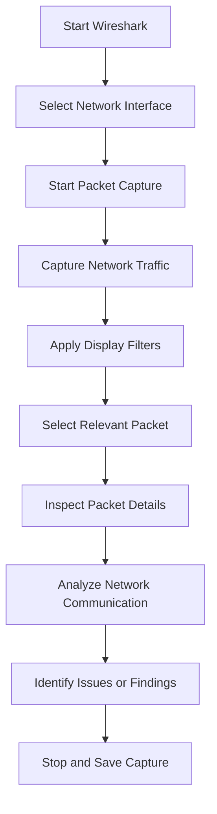
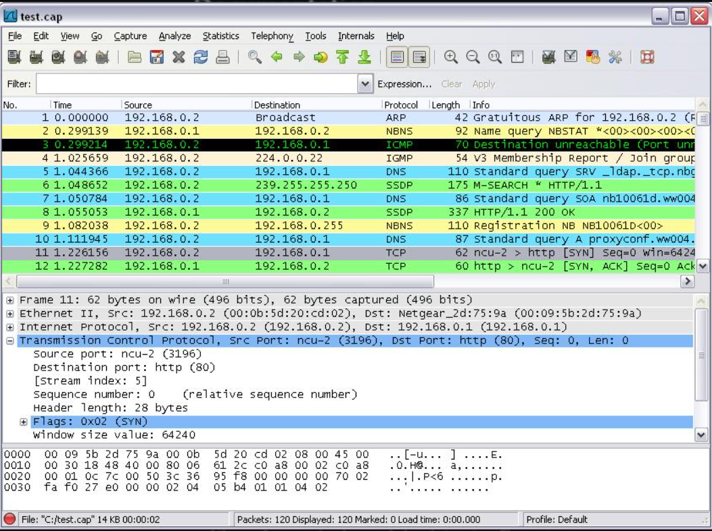
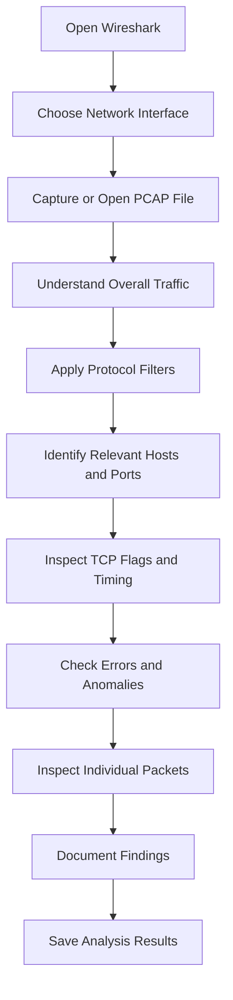

# Wireshark – Network Traffic Analysis & Display Filter Guide

<p align="center">
  
</p>

<p align="center">
  <strong>A Beginner-Friendly Guide to Network Packet Analysis and Wireshark Display Filters</strong>
</p>

<p align="center">
  
  
  
  
</p>

---

## 1. Introduction to Wireshark

**Wireshark** is a free and open-source network protocol analyzer used to capture, inspect, and analyze network traffic in real time or from previously recorded packet capture files.

It allows users to examine how devices communicate over a network by displaying individual packets and their protocol information.

When a computer communicates with another device over a network, data is transmitted in the form of packets. Wireshark captures these packets and presents their contents in a structured, readable format.

### What is Wireshark used for?

- **Network Troubleshooting:** Identify communication problems, packet loss, retransmissions, and connection failures.
- **Protocol Analysis:** Understand protocols such as TCP, UDP, HTTP, DNS, ARP, and TLS.
- **Security Analysis:** Investigate suspicious network traffic and unusual communication patterns.
- **Performance Monitoring:** Examine packet timing, response intervals, and communication delays.
- **Learning Networking:** Understand how network protocols work through real packet-level examples.

### How does Wireshark work?

1. Wireshark captures network packets from a selected network interface.
2. It analyzes packet headers and protocol information using protocol dissectors.
3. It displays the captured packets in a structured packet list.
4. Users inspect individual packets to understand their communication details.
5. Display filters help narrow down the captured traffic to relevant packets.

---

## 2. Understanding the Wireshark Interface

The Wireshark interface is generally divided into three important sections.

| Section | Description |
|---|---|
| Packet List Pane | Displays all captured packets with information such as packet number, time, source, destination, protocol, and length. |
| Packet Details Pane | Displays the selected packet's protocol layers and header information. |
| Packet Bytes Pane | Displays the raw packet data in hexadecimal and ASCII formats. |

### Packet analysis workflow



### Main interface reference



*Add your own Wireshark interface screenshot at `screenshots/wireshark-interface.png`.*

---

## 3. What Are Display Filters?

A **Display Filter** is an expression used in Wireshark to show only the packets that match specified conditions.

A packet capture may contain thousands of packets from different protocols, devices, and applications. Display filters help users focus on the traffic they want to analyze.

For example:

```wireshark
dns
```

Displays DNS packets.

```wireshark
tcp
```

Displays TCP packets.

```wireshark
ip.addr == 192.168.1.10
```

Displays packets where the specified IP address is either the source or destination.

```wireshark
tcp.port == 443
```

Displays TCP packets where either the source or destination port is 443.

### Display Filters vs Capture Filters

These two filtering methods serve different purposes.

| Feature | Capture Filter | Display Filter |
|---|---|---|
| When applied | Before or during packet capture | After packets are captured |
| Purpose | Controls which packets are captured | Controls which captured packets are displayed |
| Syntax | Uses libpcap/BPF syntax | Uses Wireshark display filter syntax |
| Example | `tcp port 443` | `tcp.port == 443` |
| Can recover excluded packets? | No | No; it only hides or shows captured packets |

**Important:** Display filters do not delete packets from the capture. They only control which packets are visible.

---

## 4. Categories of Wireshark Display Filters

Wireshark supports a large number of display filter fields. For easier learning and practical analysis, they can be organized into the following categories.

The categories below are practical learning groups, not an official fixed classification defined by Wireshark.

### 4.1 Protocol-Based Filters

Protocol-based filters are used to display packets belonging to a particular network protocol.

They are useful when investigating communication using a specific protocol.

| Filter | Description |
|---|---|
| `tcp` | Displays TCP packets. |
| `udp` | Displays UDP packets. |
| `http` | Displays HTTP packets. |
| `https` | Not a universal protocol display filter; inspect TLS or QUIC traffic depending on the connection. |
| `dns` | Displays DNS packets. |
| `arp` | Displays ARP packets. |
| `icmp` | Displays ICMP packets. |
| `tls` | Displays TLS packets. |
| `dhcp` | Displays DHCP packets when recognized by the installed dissector. |
| `quic` | Displays QUIC packets. |

**Example:**

```wireshark
dns
```

Displays DNS traffic, which is commonly used for domain-name resolution.

**Detailed guide:** [Protocol-Based Filters](filters/protocol-based-filters.md)

---

### 4.2 Port-Based Filters

Port-based filters identify network traffic based on TCP or UDP port numbers.

Ports help identify the services or applications communicating over the network.

| Filter | Description |
|---|---|
| `tcp.port == 80` | TCP traffic using port 80. |
| `tcp.port == 443` | TCP traffic using port 443. |
| `udp.port == 53` | UDP traffic using port 53. |
| `tcp.port == 22` | TCP traffic using port 22. |
| `tcp.port == 21` | TCP traffic using port 21. |
| `tcp.port == 25` | TCP traffic using port 25. |
| `tcp.port == 3389` | TCP traffic using port 3389. |
| `udp.port == 67 || udp.port == 68` | DHCP-related UDP port traffic. |

**Example:**

```wireshark
tcp.port == 443
```

Displays TCP packets where either the source or destination port is 443.

**Detailed guide:** [Port-Based Filters](filters/port-based-filters.md)

---

### 4.3 TCP Flag-Based Filters

TCP flags are control bits in the TCP header. They help manage connection establishment, data transfer, and connection termination.

TCP flag filters are particularly useful when investigating TCP handshakes and connection problems.

| Filter | Description |
|---|---|
| `tcp.flags.syn == 1` | Displays packets with the SYN flag set. |
| `tcp.flags.ack == 1` | Displays packets with the ACK flag set. |
| `tcp.flags.fin == 1` | Displays packets with the FIN flag set. |
| `tcp.flags.reset == 1` | Displays packets with the RST flag set. |
| `tcp.flags.push == 1` | Displays packets with the PSH flag set. |
| `tcp.flags.urg == 1` | Displays packets with the URG flag set. |
| `tcp.flags.ece == 1` | Displays packets with the ECE flag set. |
| `tcp.flags.cwr == 1` | Displays packets with the CWR flag set. |

**Example:**

```wireshark
tcp.flags.syn == 1 && tcp.flags.ack == 0
```

Displays initial TCP connection requests (SYN packets without ACK).

**Detailed guide:** [TCP Flag Filters](filters/tcp-flag-filters.md)

---

### 4.4 Combinational Filters

Combinational filters use logical operators to combine multiple filtering conditions.

They are useful when a single condition is not sufficient to identify the required traffic.

| Operator | Meaning | Example |
|---|---|---|
| `&&` | AND – Both conditions must be true. | `tcp && ip` |
| `||` | OR – At least one condition must be true. | `tcp || udp` |
| `!` | NOT – Excludes matching conditions. | `!dns` |
| `==` | Equal to | `tcp.port == 443` |
| `!=` | Not equal to | `ip.src != 192.168.1.10` |
| `>` | Greater than | `frame.len > 1000` |
| `<` | Less than | `frame.len < 100` |
| `>=` | Greater than or equal to | `frame.len >= 500` |
| `<=` | Less than or equal to | `frame.len <= 100` |

**Examples:**

```wireshark
tcp && ip
```

Displays packets containing both TCP and IPv4 protocol information.

```wireshark
tcp.port == 443 || udp.port == 443
```

Displays TCP or UDP traffic using port 443.

```wireshark
ip.addr == 192.168.1.10 && tcp
```

Displays TCP packets associated with the specified IP address.

**Detailed guide:** [Combinational Filters](filters/combinational-filters.md)

---

### 4.5 Time-Based Filters

Time-based filters are used to examine packets according to their timestamps and time intervals.

They help investigate communication delays, traffic timing, and packet arrival patterns.

| Filter | Description |
|---|---|
| `frame.time` | Packet timestamp field. |
| `frame.time_epoch` | Packet timestamp in Unix epoch format. |
| `frame.time_relative` | Time elapsed since the first captured packet. |
| `frame.time_delta` | Time since the previous packet in the capture. |
| `frame.time_delta_displayed` | Time since the previous displayed packet. |

**Examples:**

```wireshark
frame.time_relative > 10
```

Displays packets captured more than 10 seconds after the beginning of the capture.

```wireshark
frame.time_delta > 1
```

Displays packets with more than one second between them and the previous packet in the capture.

**Important:** Packet time differences do not automatically represent application response time or network latency.

**Detailed guide:** [Time-Based Filters](filters/time-based-filters.md)

---

### 4.6 Error and Network Troubleshooting Filters

These filters help identify communication anomalies, TCP analysis events, and protocol errors.

They are useful for troubleshooting network connectivity and investigating unusual traffic behavior.

| Filter | Description |
|---|---|
| `tcp.analysis.retransmission` | Displays TCP retransmissions detected by Wireshark. |
| `tcp.analysis.fast_retransmission` | Displays TCP fast retransmissions. |
| `tcp.analysis.duplicate_ack` | Displays duplicate TCP acknowledgments. |
| `tcp.analysis.lost_segment` | Displays packets where Wireshark infers a missing TCP segment. |
| `tcp.analysis.out_of_order` | Displays TCP packets detected as out of order. |
| `tcp.analysis.zero_window` | Displays TCP zero-window advertisements. |
| `tcp.analysis.window_full` | Displays TCP window-full events. |
| `icmp.type == 3` | Displays ICMP destination unreachable messages. |
| `dns.flags.rcode != 0` | Displays DNS responses with non-zero response codes. |
| `_ws.malformed` | Displays packets marked as malformed by Wireshark. |

**Example:**

```wireshark
tcp.analysis.retransmission
```

Displays TCP retransmissions detected by Wireshark, which may help investigate packet loss or congestion.

**Important:** A retransmission, duplicate ACK, or malformed-packet indication is not automatically proof of a cyberattack. Interpret these findings using packet context and capture conditions.

**Detailed guide:** [Error Analysis Filters](filters/error-analysis-filters.md)

---

## 5. Additional Useful Display Filter Categories

Apart from the six main categories, the following groups are also valuable for practical network analysis.

### 5.1 IP Address-Based Filters

Used to investigate communication between specific hosts or networks.

| Filter | Description |
|---|---|
| `ip.addr == 192.168.1.10` | Source or destination IPv4 address. |
| `ip.src == 192.168.1.10` | Source IPv4 address. |
| `ip.dst == 192.168.1.10` | Destination IPv4 address. |
| `ip.addr == 192.168.1.0/24` | IPv4 address within the specified subnet. |
| `ipv6` | Displays IPv6 packets. |
| `ipv6.src == 2001:db8::1` | Source IPv6 address. |

**Example:**

```wireshark
ip.src == 192.168.1.10
```

Displays packets originating from the specified IPv4 address.

---

### 5.2 Ethernet and MAC Address Filters

Used to investigate communication at the Ethernet data-link layer.

| Filter | Description |
|---|---|
| `eth` | Displays Ethernet packets. |
| `eth.src == aa:bb:cc:dd:ee:ff` | Matches the source MAC address. |
| `eth.dst == aa:bb:cc:dd:ee:ff` | Matches the destination MAC address. |
| `eth.addr == aa:bb:cc:dd:ee:ff` | Matches either source or destination MAC address. |

**Example:**

```wireshark
eth.addr == aa:bb:cc:dd:ee:ff
```

Displays Ethernet packets associated with the specified MAC address.

---

### 5.3 DNS-Based Filters

DNS filters are useful for analyzing domain-name resolution and DNS response behavior.

| Filter | Description |
|---|---|
| `dns` | Displays DNS packets. |
| `dns.flags.response == 1` | Displays DNS responses. |
| `dns.flags.response == 0` | Displays DNS queries. |
| `dns.flags.rcode == 3` | Displays NXDOMAIN responses. |
| `dns.flags.rcode == 2` | Displays SERVFAIL responses. |
| `dns.qry.name contains "example"` | Matches DNS query names containing the specified text. |

**Example:**

```wireshark
dns.flags.response == 0
```

Displays DNS queries sent by clients.

---

### 5.4 HTTP-Based Filters

Used to inspect HTTP requests and responses when the traffic is available in plaintext and decoded as HTTP.

| Filter | Description |
|---|---|
| `http` | Displays HTTP packets. |
| `http.request` | Displays HTTP requests. |
| `http.response` | Displays HTTP responses. |
| `http.request.method == "GET"` | Displays HTTP GET requests. |
| `http.request.method == "POST"` | Displays HTTP POST requests. |
| `http.response.code == 404` | Displays HTTP 404 responses. |
| `http.response.code >= 400` | Displays HTTP responses with status codes of 400 or greater. |

**Example:**

```wireshark
http.request.method == "POST"
```

Displays HTTP POST requests.

**Note:** HTTPS application data is encrypted. HTTP display filters generally cannot inspect encrypted HTTPS request contents unless decryption is configured and supported.

---

### 5.5 TLS and Encrypted Traffic Filters

Used to inspect TLS handshake information and other TLS-related packet fields.

| Filter | Description |
|---|---|
| `tls` | Displays TLS packets. |
| `tls.handshake` | Displays TLS handshake packets. |
| `tls.handshake.type == 1` | Displays Client Hello messages. |
| `tls.handshake.type == 2` | Displays Server Hello messages. |
| `tls.record.content_type == 22` | Displays TLS handshake records. |
| `quic` | Displays QUIC traffic when decoded by Wireshark. |

**Example:**

```wireshark
tls.handshake.type == 1
```

Displays TLS Client Hello messages.

---

### 5.6 UDP and ICMP Filters

These filters help inspect connectionless transport traffic and network-layer diagnostic messages.

| Filter | Description |
|---|---|
| `udp` | Displays UDP packets. |
| `udp.srcport == 53` | Displays packets with UDP source port 53. |
| `udp.dstport == 53` | Displays packets with UDP destination port 53. |
| `icmp` | Displays ICMP packets. |
| `icmp.type == 8` | Displays ICMP Echo Requests. |
| `icmp.type == 0` | Displays ICMP Echo Replies. |
| `icmp.type == 3` | Displays ICMP Destination Unreachable messages. |
| `icmp.type == 11` | Displays ICMP Time Exceeded messages. |

**Example:**

```wireshark
icmp.type == 8 || icmp.type == 0
```

Displays ICMP Echo Requests and Echo Replies, commonly associated with ping.

---

### 5.7 Packet Size and Frame-Based Filters

Used to analyze packet lengths and frame-level properties.

| Filter | Description |
|---|---|
| `frame` | Displays captured frames. |
| `frame.len > 1000` | Displays frames larger than 1000 bytes. |
| `frame.len < 100` | Displays frames smaller than 100 bytes. |
| `frame.number == 10` | Displays frame number 10. |
| `frame.cap_len < frame.len` | Displays frames where the captured length is smaller than the reported frame length. |

**Example:**

```wireshark
frame.len > 1500
```

Displays frames larger than 1500 bytes.

---

### 5.8 Field Existence and Content Filters

These expressions help identify packets that contain a particular field or match specific field values.

| Expression | Description |
|---|---|
| `tcp.options` | Matches packets containing TCP options. |
| `tcp.options.mss` | Matches packets containing the TCP MSS option. |
| `dns.qry.name` | Matches packets containing a DNS query-name field. |
| `http.host` | Matches packets containing an HTTP Host field. |
| `http.request.method contains "GET"` | Matches HTTP request methods containing the text GET. |
| `dns.qry.name matches ".*example.*"` | Uses a regular expression to match DNS query names containing example. |

**Example:**

```wireshark
tcp.options.mss
```

Displays packets containing the TCP Maximum Segment Size option.

**Note:** Field availability depends on protocol dissection and the installed Wireshark version. Check the official Display Filter Reference for exact field names.

---

## 6. Quick Reference: Important Display Filters

The following table provides commonly used filters for everyday packet analysis.

| Purpose | Display Filter |
|---|---|
| All TCP traffic | `tcp` |
| All UDP traffic | `udp` |
| DNS traffic | `dns` |
| HTTP traffic | `http` |
| TLS traffic | `tls` |
| Specific IP address | `ip.addr == 192.168.1.10` |
| Specific source IP | `ip.src == 192.168.1.10` |
| Specific destination IP | `ip.dst == 192.168.1.10` |
| HTTPS-related TCP port | `tcp.port == 443` |
| DNS port | `udp.port == 53` |
| Initial TCP SYN | `tcp.flags.syn == 1 && tcp.flags.ack == 0` |
| TCP RST | `tcp.flags.reset == 1` |
| TCP retransmissions | `tcp.analysis.retransmission` |
| Duplicate ACKs | `tcp.analysis.duplicate_ack` |
| DNS failures | `dns.flags.rcode != 0` |
| ICMP ping requests | `icmp.type == 8` |
| Large packets | `frame.len > 1500` |
| Packets after 10 seconds | `frame.time_relative > 10` |
| Exclude DNS | `!dns` |
| TCP or UDP | `tcp || udp` |

---

## 7. Practical Network Analysis Workflow

Follow this workflow when analyzing a packet capture.



### Recommended analysis sequence

1. Start by identifying the protocols present in the capture.
2. Identify source and destination IP addresses.
3. Examine commonly used TCP and UDP ports.
4. Inspect TCP flags to understand connection establishment and termination.
5. Analyze packet timestamps and intervals.
6. Look for retransmissions, duplicate ACKs, and other troubleshooting indicators.
7. Inspect relevant packet details and document your findings.

### Example analysis

Suppose you want to investigate a TCP connection using port 443.

**Step 1 – Identify the traffic**

```wireshark
tcp.port == 443
```

**Step 2 – Identify initial connection requests**

```wireshark
tcp.flags.syn == 1 && tcp.flags.ack == 0
```

**Step 3 – Identify connection resets**

```wireshark
tcp.flags.reset == 1
```

**Step 4 – Check for retransmissions**

```wireshark
tcp.analysis.retransmission
```

**Step 5 – Inspect the relevant packets**

Select a packet and examine its packet details, source, destination, TCP flags, timestamps, and available protocol fields.

This sequence helps build an understanding of the connection without assuming that a single packet indicates the root cause of a problem.

---

## 8. Repository Documentation – Detailed Filter Guides

This repository contains separate Markdown documents for the six main display-filter categories.

Each document provides detailed explanations, filter syntax, practical examples, use cases, and analysis guidance.

### Detailed documentation

| No. | Category | Description | Documentation |
|---|---|---|---|
| 1 | Protocol-Based Filters | Analyze traffic according to protocols such as TCP, UDP, DNS, HTTP, and TLS. | [Open Guide](filters/protocol-based-filters.md) |
| 2 | Port-Based Filters | Identify network services and traffic using TCP and UDP ports. | [Open Guide](filters/port-based-filters.md) |
| 3 | TCP Flag Filters | Analyze TCP connection establishment, acknowledgments, and termination. | [Open Guide](filters/tcp-flag-filters.md) |
| 4 | Combinational Filters | Combine conditions using logical operators and comparisons. | [Open Guide](filters/combinational-filters.md) |
| 5 | Time-Based Filters | Investigate timestamps, packet intervals, and relative timing. | [Open Guide](filters/time-based-filters.md) |
| 6 | Error Analysis Filters | Investigate retransmissions, duplicate ACKs, DNS errors, and other anomalies. | [Open Guide](filters/error-analysis-filters.md) |

### Additional reference material

For more filter categories, consult the official Wireshark Display Filter Reference:

[Wireshark Display Filter Reference](https://www.wireshark.org/docs/dfref/)

---

## 9. Screenshots and Visual References

Screenshots help beginners understand how to apply filters and interpret packet details.

Recommended screenshot directory:

```text
screenshots/
├── wireshark-interface.png
├── protocol-filters.png
├── port-filters.png
├── tcp-flags.png
├── combinational-filters.png
├── time-filters.png
└── error-analysis.png
```

### Example screenshot references

**Protocol-Based Filtering**


**Port-Based Filtering**


**TCP Flag Analysis**


**Combinational Filtering**


**Time-Based Filtering**


**Error Analysis**


*These image paths are references for screenshots you should capture from your own Wireshark installation. Add the corresponding image files to the `screenshots/` folder for them to appear on GitHub.*

---

## 10. Best Practices for Using Wireshark

- Select the correct network interface before starting packet capture.
- Use display filters to narrow down large captures.
- Start with simple filters before combining multiple conditions.
- Verify filter syntax using the official Wireshark Display Filter Reference.
- Understand the difference between TCP and UDP ports.
- Do not assume that a port number uniquely identifies an application.
- Remember that TCP port 443 and UDP port 443 represent different transport traffic; QUIC commonly uses UDP.
- Consider checksum offloading and capture limitations when interpreting checksum warnings.
- Do not treat retransmissions or duplicate ACKs as definitive proof of an attack.
- Use packet details and surrounding traffic to support your conclusions.
- Capture and analyze only network traffic that you are authorized to inspect.

---

## 11. Learning Resources and Official References

The following resources provide authoritative documentation and additional learning material.

| Resource | Description | Link |
|---|---|---|
| Wireshark Official Website | Download Wireshark and learn about the tool. | [Visit Website](https://www.wireshark.org/) |
| Wireshark User Guide | Complete documentation for using Wireshark. | [Read Guide](https://www.wireshark.org/docs/wsug_html_chunked/) |
| Display Filter Reference | Search for supported display filter fields. | [Open Reference](https://www.wireshark.org/docs/dfref/) |
| Display Filter Expressions | Learn display filter syntax and expressions. | [Read Documentation](https://www.wireshark.org/docs/wsug_html_chunked/ChWorkBuildDisplayFilterSection.html) |
| Filtering Packets | Learn how to filter packets while viewing captures. | [Read Documentation](https://www.wireshark.org/docs/wsug_html_chunked/ChWorkDisplayFilterSection.html) |
| Wireshark Filter Manual | Detailed filter language reference. | [Read Manual](https://www.wireshark.org/docs/man-pages/wireshark-filter) |
| Wireshark Wiki | Community-maintained filtering and analysis examples. | [Visit Wiki](https://wiki.wireshark.org/DisplayFilters/) |
| TShark Manual | Command-line packet analysis documentation. | [Read Manual](https://www.wireshark.org/docs/man-pages/tshark.html) |

---

## 12. Conclusion

Wireshark is an essential tool for understanding network communication, troubleshooting connectivity issues, and performing packet-level analysis.

Display filters make network analysis more efficient by allowing users to isolate specific protocols, ports, IP addresses, TCP flags, timestamps, and network anomalies.

This repository provides a structured learning reference, beginning with fundamental display filters and progressing toward practical network troubleshooting and analysis.

By understanding and applying these filters, users can develop practical skills in network monitoring, protocol analysis, and cybersecurity investigations.

---

## 13. Repository Structure

The recommended GitHub repository structure is:

```text
wireshark-network-analysis/
│
├── README.md
│
├── filters/
│   ├── protocol-based-filters.md
│   ├── port-based-filters.md
│   ├── tcp-flag-filters.md
│   ├── combinational-filters.md
│   ├── time-based-filters.md
│   └── error-analysis-filters.md
│
└── screenshots/
    ├── wireshark-interface.png
    ├── protocol-filters.png
    ├── port-filters.png
    ├── tcp-flags.png
    ├── combinational-filters.png
    ├── time-filters.png
    └── error-analysis.png
```

**Important:** Keep the `README.md` in the repository root and the six detailed guides inside the `filters/` folder. The relative links in this README will then navigate to the corresponding files on GitHub.

---

<p align="center">
  <strong>Wireshark Network Analysis & Display Filter Reference</strong>
  <br>
  Learn • Capture • Filter • Analyze
</p>
