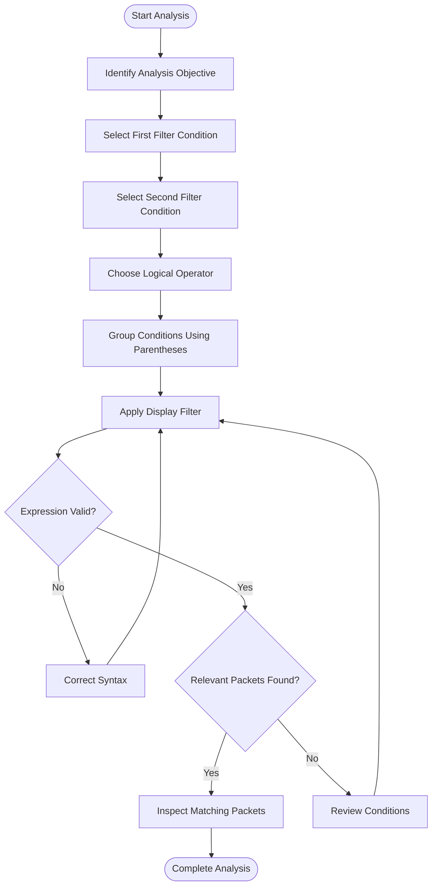

# Wireshark Combinational Display Filters

> A detailed guide to combining multiple Wireshark display-filter conditions using logical and comparison operators.

## 1. Introduction

Combinational display filters allow users to apply multiple conditions within a single filter expression.

Instead of displaying all packets belonging to a protocol or port, users can combine conditions to isolate specific communication.

For example:

```wireshark
ip.addr == 192.168.1.10 and tcp.port == 443
```

This expression displays IPv4 TCP packets involving the specified IP address and port 443.

Combinational filtering is useful for:
- Focused packet analysis.
- Identifying communication between specific hosts.
- Investigating application traffic.
- Isolating unusual network behavior.
- Reducing irrelevant packets during troubleshooting.

## 2. Logical Operators

| Operator | Alternative | Meaning |
|---|---|---|
| `and` | `&&` | Both conditions must be true. |
| `or` | `||` | At least one condition must be true. |
| `not` | `!` | Reverses a condition. |
| `xor` | `^^` | Exactly one condition must be true. |

### 2.1 AND Operator

Both conditions must match.

```wireshark
tcp and ip
```

Displays packets containing both TCP and IPv4.

### 2.2 OR Operator

At least one condition must match.

```wireshark
tcp or udp
```

Displays TCP or UDP packets.

### 2.3 NOT Operator

Excludes packets matching a condition.

```wireshark
not arp
```

Displays packets that do not match the ARP filter.

### 2.4 XOR Operator

Exactly one of the two conditions must match.

```wireshark
tcp.flags.syn == 1 xor tcp.flags.fin == 1
```

Displays packets where exactly one of the SYN or FIN conditions is true.

## 3. Comparison Operators

| Operator | Meaning | Example |
|---|---|---|
| `==` | Equal | `tcp.port == 443` |
| `!=` | Not equal | `ip.src != 192.168.1.10` |
| `>` | Greater than | `frame.len > 1000` |
| `<` | Less than | `frame.len < 100` |
| `>=` | Greater than or equal | `tcp.port >= 1024` |
| `<=` | Less than or equal | `udp.length <= 100` |
| `contains` | Contains specified content | `http.host contains "example"` |
| `matches` | Matches regular expression | `http.host matches "example\\.(com|org)"` |
| `in` | Matches a member of a set or range | `tcp.port in {80 443 8080}` |

## 4. Parentheses and Filter Grouping

Parentheses are useful when combining several conditions.

Example:

```wireshark
ip.src == 192.168.1.10 and (tcp or udp)
```

This expression displays TCP or UDP packets originating from the specified IPv4 address.

Another example:

```wireshark
(tcp.port == 80 or tcp.port == 443) and ip
```

This expression displays matching IPv4 TCP packets involving either port 80 or 443.

Use parentheses to make complex expressions readable and to control how conditions are grouped.

## 5. Common Combinational Filters

| Display Filter | Description |
|---|---|
| `tcp and ip` | TCP over IPv4. |
| `tcp or udp` | TCP and UDP traffic. |
| `dns or http` | DNS or HTTP traffic. |
| `not arp` | Excludes ARP packets. |
| `ip.addr == 192.168.1.10 and tcp` | TCP packets involving the specified IPv4 address. |
| `ip.src == 192.168.1.10 and ip.dst == 192.168.1.20` | Packets from one specified IPv4 address to another. |
| `tcp.port == 80 or tcp.port == 443` | TCP traffic involving port 80 or 443. |
| `udp.port == 53 and dns` | DNS packets using UDP port 53. |
| `tcp.flags.syn == 1 and tcp.flags.ack == 0` | Initial SYN packets. |
| `tcp and not tcp.flags.reset` | TCP packets without the RST flag set. |
| `frame.len > 1000 and tcp` | TCP packets with frames larger than 1000 bytes. |

## 6. Advanced Practical Examples

### Example 1: Traffic from a specific host

```wireshark
ip.addr == 192.168.1.10
```

Displays IPv4 packets where the specified address is the source or destination.

### Example 2: TCP traffic from a specific host

```wireshark
ip.addr == 192.168.1.10 and tcp
```

Displays TCP packets involving that host.

### Example 3: HTTP and HTTPS-related TCP ports

```wireshark
tcp.port == 80 or tcp.port == 443
```

Displays TCP packets involving port 80 or 443.

### Example 4: DNS errors

```wireshark
dns.flags.response == 1 and dns.flags.rcode != 0
```

Displays DNS responses with a non-zero response code.

### Example 5: TCP retransmissions involving a host

```wireshark
tcp.analysis.retransmission and ip.addr == 192.168.1.10
```

Displays retransmission events involving the specified IPv4 address.

### Example 6: Large TCP packets

```wireshark
tcp and frame.len > 1000
```

Displays TCP packets whose captured frame length exceeds 1000 bytes.

### Example 7: Exclude DNS and ARP

```wireshark
not (dns or arp)
```

Displays packets that do not match DNS or ARP.

## 7. Combinational Filtering Workflow



## 8. Practical Applications

| Investigation | Example Filter |
|---|---|
| Specific host traffic | `ip.addr == 192.168.1.10` |
| Specific host TCP traffic | `ip.addr == 192.168.1.10 and tcp` |
| DNS failures | `dns.flags.rcode != 0` |
| TCP retransmissions | `tcp.analysis.retransmission` |
| TCP reset events | `tcp.flags.reset == 1` |
| Large UDP packets | `udp and frame.len > 1000` |
| Exclude ARP | `not arp` |
| Specific source and destination | `ip.src == 192.168.1.10 and ip.dst == 192.168.1.20` |

## 9. Best Practices

1. Start with simple filter expressions.
2. Add conditions one at a time.
3. Use parentheses for complex expressions.
4. Validate each field name against the Display Filter Reference.
5. Use logical operators carefully.
6. Keep filters readable.
7. Save frequently used expressions for reuse.

## 10. Important Considerations

- Display-filter expressions are not the same as capture-filter expressions.
- Incorrect field names can cause syntax errors.
- Multiple conditions can reduce the number of displayed packets significantly.
- A matching expression identifies packet properties, not necessarily the cause of a network problem.

## 11. References

- [Wireshark Building Display Filter Expressions](https://www.wireshark.org/docs/wsug_html_chunked/ChWorkBuildDisplayFilterSection.html)
- [Wireshark Display Filter Manual](https://www.wireshark.org/docs/man-pages/wireshark-filter)
- [Wireshark Display Filter Reference](https://www.wireshark.org/docs/dfref/)

---

**Combinational Filtering – Combine Conditions. Isolate Traffic. Improve Analysis.**