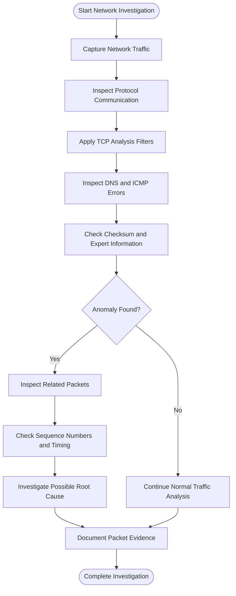

# Wireshark Error and Anomaly Analysis Display Filters

> A detailed guide to investigating TCP analysis events, protocol errors, checksum warnings, and unusual packet behavior.

## 1. Introduction

Wireshark provides packet-analysis fields and expert information that help identify unusual network communication and protocol conditions.

Error and anomaly analysis is useful for investigating:
- TCP retransmissions.
- Duplicate acknowledgements.
- Out-of-order packets.
- Suspected missing segments.
- Zero-window conditions.
- TCP resets.
- DNS response failures.
- ICMP error messages.
- Checksum warnings.
- Malformed packets.

These observations can help identify possible communication problems, but they must be interpreted using packet context and additional evidence.

## 2. Error and Anomaly Analysis Workflow



## 3. TCP Analysis Filters

Wireshark performs TCP analysis and exposes fields that identify certain packet conditions.

### 3.1 TCP Retransmission

```wireshark
tcp.analysis.retransmission
```

**Description:** Displays TCP packets identified by Wireshark's analysis as retransmissions.

**Possible investigation areas:**
- Packet loss.
- Missing acknowledgements.
- Congestion.
- Capture loss.
- Delayed packet delivery.

**Analysis procedure:**
1. Identify the retransmitted packet.
2. Inspect its sequence number.
3. Locate the original transmission if available.
4. Examine the corresponding acknowledgements.
5. Review surrounding packet timing.

### 3.2 TCP Fast Retransmission

```wireshark
tcp.analysis.fast_retransmission
```

**Description:** Displays TCP packets identified as fast retransmissions.

Investigate:
- Duplicate acknowledgements.
- Sequence numbers.
- Packet ordering.
- Related TCP stream events.

### 3.3 Duplicate Acknowledgements

```wireshark
tcp.analysis.duplicate_ack
```

**Description:** Displays duplicate ACK events identified by Wireshark.

Duplicate acknowledgements may occur when the receiver continues acknowledging the same sequence point.

Investigate:
- Repeated acknowledgement numbers.
- Missing or delayed segments.
- Retransmission events.
- Packet ordering.

### 3.4 Lost Segment Indication

```wireshark
tcp.analysis.lost_segment
```

**Description:** Displays packets associated with a suspected missing TCP segment.

A missing-segment indication may be influenced by capture position or packet loss during capture.

### 3.5 Out-of-Order Packets

```wireshark
tcp.analysis.out_of_order
```

**Description:** Displays TCP packets identified as arriving out of sequence.

Investigate:
- Sequence numbers.
- Timestamps.
- Related retransmissions.
- Network path behavior.

### 3.6 Zero Window

```wireshark
tcp.analysis.zero_window
```

**Description:** Displays TCP packets advertising a zero receive window.

This indicates that the receiver is temporarily advertising that it cannot accept additional data through the TCP receive window.

Investigate:
- The receiving endpoint.
- Application consumption behavior.
- Related window updates.
- Whether the zero-window condition persists.

### 3.7 Window Full

```wireshark
tcp.analysis.window_full
```

**Description:** Displays TCP packets identified by Wireshark as filling the receiver's advertised window.

Investigate:
- Advertised window size.
- Subsequent acknowledgements.
- Window updates.
- Application and receiver behavior.

### 3.8 ACK of a Lost Segment

```wireshark
tcp.analysis.ack_lost_segment
```

**Description:** Displays ACK packets associated with a suspected lost segment.

Use this field together with sequence and acknowledgement numbers to investigate the communication sequence.

## 4. TCP Anomaly Filter Reference

| Display Filter | Description |
|---|---|
| `tcp.analysis.retransmission` | TCP retransmissions. |
| `tcp.analysis.fast_retransmission` | Fast retransmissions. |
| `tcp.analysis.duplicate_ack` | Duplicate ACK events. |
| `tcp.analysis.lost_segment` | Suspected missing TCP segments. |
| `tcp.analysis.out_of_order` | Out-of-order TCP packets. |
| `tcp.analysis.zero_window` | Zero-window events. |
| `tcp.analysis.window_full` | Window-full events. |
| `tcp.analysis.ack_lost_segment` | ACK packets associated with a suspected lost segment. |
| `tcp.flags.reset == 1` | TCP reset packets. |

## 5. ICMP Error Analysis Filters

ICMP provides control and error-reporting messages for IPv4 communication.

### Common ICMP filters

| Display Filter | Description |
|---|---|
| `icmp` | Displays ICMP packets. |
| `icmp.type == 3` | Destination Unreachable messages. |
| `icmp.type == 11` | Time Exceeded messages. |
| `icmp.type == 8` | Echo Request messages. |
| `icmp.type == 0` | Echo Reply messages. |

### Example 1: Destination Unreachable

```wireshark
icmp.type == 3
```

Displays ICMP Destination Unreachable messages.

Investigate:
- Source and destination addresses.
- ICMP code.
- Embedded original packet information.
- Whether the issue is related to routing, filtering, or host availability.

### Example 2: Time Exceeded

```wireshark
icmp.type == 11
```

Displays ICMP Time Exceeded messages.

These messages can occur when a packet's TTL reaches zero or a relevant timer expires.

### Example 3: Ping requests and responses

```wireshark
icmp.type == 8 or icmp.type == 0
```

Displays IPv4 ICMP Echo Requests and Echo Replies.

## 6. DNS Error Analysis Filters

DNS response codes help identify name-resolution failures.

| Display Filter | Description |
|---|---|
| `dns.flags.response == 1` | DNS responses. |
| `dns.flags.rcode != 0` | DNS responses with a non-zero response code. |
| `dns.flags.rcode == 2` | DNS Server Failure (SERVFAIL). |
| `dns.flags.rcode == 3` | DNS Name Error (NXDOMAIN). |

### Example 1: Identify DNS errors

```wireshark
dns.flags.response == 1 and dns.flags.rcode != 0
```

Displays DNS responses with non-zero response codes.

### Example 2: Identify NXDOMAIN responses

```wireshark
dns.flags.rcode == 3
```

Displays DNS responses indicating that the requested name does not exist.

### Example 3: Identify SERVFAIL responses

```wireshark
dns.flags.rcode == 2
```

Displays DNS Server Failure responses.

## 7. Checksum Analysis Filters

Checksums are used to detect errors in packet data.

Wireshark can expose checksum-related fields and identify packets marked with checksum problems.

| Display Filter | Description |
|---|---|
| `ip.checksum_bad` | IPv4 packets marked with a bad checksum. |
| `tcp.checksum_bad` | TCP packets marked with a bad checksum. |
| `udp.checksum_bad` | UDP packets marked with a bad checksum. |

### Example 1: IPv4 checksum warnings

```wireshark
ip.checksum_bad
```

Displays IPv4 packets marked with a bad checksum.

### Example 2: TCP checksum warnings

```wireshark
tcp.checksum_bad
```

Displays TCP packets marked with a bad checksum.

### Example 3: UDP checksum warnings

```wireshark
udp.checksum_bad
```

Displays UDP packets marked with a bad checksum.

**Important:** Checksum warnings may result from checksum offloading, capture location, incomplete packets, or other capture conditions. Verify the capture environment before concluding that packets were corrupted in transit.

## 8. Malformed Packet Analysis

Wireshark may identify packets as malformed when a dissector cannot interpret the packet structure as expected.

A useful display-filter field is:

```wireshark
_ws.malformed
```

**Description:** Displays packets marked as malformed by Wireshark.

Investigate:
- Packet length.
- Header structure.
- Protocol-specific fields.
- Truncated capture data.
- Whether the packet is genuinely malformed or incomplete due to capture conditions.

## 9. Expert Information

Wireshark includes an Expert Information interface for reviewing noteworthy protocol conditions.

Open:

`Analyze → Expert Information`

It helps group protocol observations into categories such as:
- Errors.
- Warnings.
- Notes.
- Chats.

The exact messages depend on the protocol, dissector, and Wireshark version.

Expert Information is a diagnostic aid, not an automatic root-cause analysis tool.

## 10. Practical Investigation Scenarios

### Scenario 1: Investigate retransmissions

```wireshark
tcp.analysis.retransmission
```

Steps:
1. Locate the retransmitted packet.
2. Inspect its TCP sequence number.
3. Find related packets in the same stream.
4. Examine acknowledgements.
5. Compare packet timestamps.
6. Document the observation.

### Scenario 2: Investigate duplicate acknowledgements

```wireshark
tcp.analysis.duplicate_ack
```

Steps:
1. Identify repeated ACK events.
2. Compare acknowledgement numbers.
3. Inspect preceding TCP packets.
4. Look for missing sequence ranges.
5. Check whether retransmissions follow.

### Scenario 3: Investigate zero-window events

```wireshark
tcp.analysis.zero_window
```

Steps:
1. Identify the endpoint advertising a zero window.
2. Inspect the advertised window size.
3. Review subsequent window updates.
4. Examine the communication sequence.
5. Investigate receiver or application behavior.

### Scenario 4: Investigate DNS failures

```wireshark
dns.flags.response == 1 and dns.flags.rcode != 0
```

Steps:
1. Identify the DNS response.
2. Inspect the query name.
3. Examine the response code.
4. Locate the corresponding DNS query.
5. Document the result.

### Scenario 5: Investigate malformed packets

```wireshark
_ws.malformed
```

Steps:
1. Select the matching packet.
2. Inspect the Packet Details pane.
3. Examine the reported malformed condition.
4. Check the captured packet length.
5. Verify whether the capture was truncated.

## 11. Common Anomaly Interpretation

| Observation | Possible Explanation | What to Investigate |
|---|---|---|
| Retransmission | Segment may not have been acknowledged. | Sequence numbers, ACKs, timing. |
| Duplicate ACK | Receiver repeats an acknowledgement point. | Missing segments and packet ordering. |
| Out-of-order | Segments observed in a different sequence. | Timestamps, sequence numbers, network path. |
| Zero window | Receiver advertises no available receive-window space. | Receiver application, window updates. |
| TCP reset | Connection was reset or aborted. | Connection state and preceding packets. |
| DNS NXDOMAIN | Requested DNS name does not exist according to the response. | Query name and response. |
| ICMP Destination Unreachable | Destination or service cannot be reached under the reported condition. | ICMP code and route. |
| Bad checksum | Packet checksum is marked invalid. | Offloading, capture position, packet integrity. |
| Malformed packet | Protocol structure could not be decoded as expected. | Packet bytes, length, protocol fields. |

## 12. Best Practices

1. Inspect surrounding packets before interpreting an anomaly.
2. Examine TCP sequence and acknowledgement numbers.
3. Correlate events within the same TCP stream.
4. Review packet timestamps.
5. Check Expert Information.
6. Consider capture loss and capture position.
7. Check checksum offloading before reporting checksum errors.
8. Distinguish a Wireshark warning from a confirmed network fault.
9. Record the exact filter and supporting packet evidence.
10. Avoid declaring malicious activity based only on one anomaly.

## 13. Important Limitations

- Wireshark's TCP analysis uses heuristics and captured packet context.
- A missing segment in a capture does not necessarily mean the network lost that segment.
- Retransmissions can be caused by several different conditions.
- Checksum warnings can be caused by hardware offloading.
- Expert Information messages depend on protocol dissectors.
- A single anomaly does not prove a network attack or identify its root cause.

## 14. References

- [TCP Display Filter Reference](https://www.wireshark.org/docs/dfref/t/tcp.html)
- [Wireshark Display Filter Reference](https://www.wireshark.org/docs/dfref/)
- [Wireshark User Guide](https://www.wireshark.org/docs/wsug_html/)
- [Wireshark Display Filter Manual](https://www.wireshark.org/docs/man-pages/wireshark-filter)
- [Wireshark Display Filters Wiki](https://wiki.wireshark.org/DisplayFilters/)

---

**Error and Anomaly Analysis – Detect. Investigate. Correlate. Verify.**
