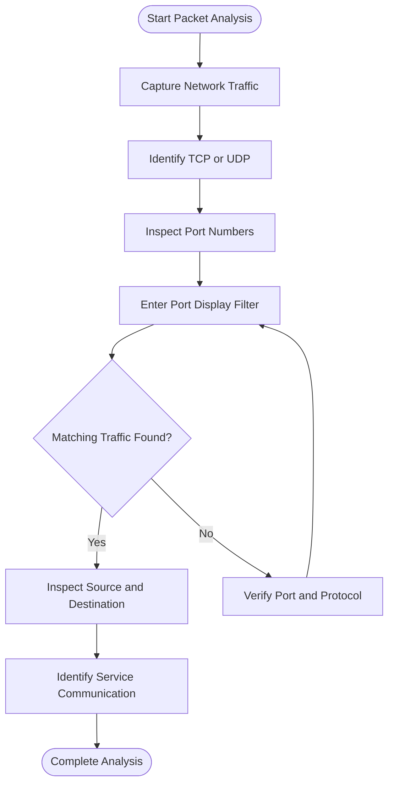

# Wireshark Port-Based Display Filters

> A detailed guide to filtering network traffic using TCP and UDP port numbers.

## 1. Introduction

Port-based display filters are used to identify network communication associated with specific TCP or UDP port numbers.

A port number identifies a communication endpoint used by an application or network service.

For example:
- Port 80 is commonly associated with HTTP.
- Port 443 is commonly associated with HTTPS over TCP.
- Port 53 is commonly associated with DNS.
- Port 22 is commonly associated with SSH.

Wireshark allows users to filter packets based on source ports, destination ports, or either endpoint.

## 2. Understanding Network Ports

TCP and UDP use 16-bit port numbers ranging from 0 to 65535.

| Port Range | Classification |
|---|---|
| 0–1023 | Well-known ports |
| 1024–49151 | Registered ports |
| 49152–65535 | Dynamic/private ports (commonly used as ephemeral ports) |

### Common service ports

| Port | Protocol / Service |
|---:|---|
| 20/21 | FTP |
| 22 | SSH |
| 23 | Telnet |
| 25 | SMTP |
| 53 | DNS |
| 67/68 | DHCP |
| 80 | HTTP |
| 110 | POP3 |
| 123 | NTP |
| 143 | IMAP |
| 443 | HTTPS |
| 3306 | MySQL |
| 3389 | RDP |
| 5432 | PostgreSQL |

A service may use a non-standard port, and traffic on a standard port is not guaranteed to be that service.

## 3. Port-Based Filtering Workflow



## 4. TCP Port-Based Filters

| Display Filter | Description |
|---|---|
| `tcp.port == 80` | Displays TCP packets using port 80 as source or destination. |
| `tcp.port == 443` | Displays TCP packets using port 443. |
| `tcp.port == 22` | Displays TCP packets using port 22. |
| `tcp.srcport == 80` | Displays TCP packets with source port 80. |
| `tcp.dstport == 443` | Displays TCP packets with destination port 443. |
| `tcp.port == 3306` | Displays TCP packets using port 3306. |
| `tcp.port == 3389` | Displays TCP packets using port 3389. |

### Example 1: HTTP port traffic

```wireshark
tcp.port == 80
```

Displays TCP traffic where either the source or destination port is 80.

### Example 2: HTTPS-related TCP port traffic

```wireshark
tcp.port == 443
```

Displays TCP traffic involving port 443.

### Example 3: SSH traffic

```wireshark
tcp.port == 22
```

Displays TCP traffic involving port 22.

### Example 4: Source port filtering

```wireshark
tcp.srcport == 443
```

Displays packets whose TCP source port is 443.

### Example 5: Destination port filtering

```wireshark
tcp.dstport == 80
```

Displays packets whose TCP destination port is 80.

## 5. UDP Port-Based Filters

| Display Filter | Description |
|---|---|
| `udp.port == 53` | Displays UDP packets using port 53 as source or destination. |
| `udp.srcport == 53` | Displays UDP packets with source port 53. |
| `udp.dstport == 53` | Displays UDP packets with destination port 53. |
| `udp.port == 67` | Displays UDP packets involving port 67. |
| `udp.port == 68` | Displays UDP packets involving port 68. |
| `udp.port == 123` | Displays UDP packets involving port 123. |
| `udp.port == 161` | Displays UDP packets involving port 161. |

### Example 1: DNS port traffic

```wireshark
udp.port == 53
```

Displays UDP traffic involving port 53.

### Example 2: NTP traffic

```wireshark
udp.port == 123
```

Displays UDP traffic involving port 123.

### Example 3: DHCP-related traffic

```wireshark
udp.port == 67 or udp.port == 68
```

Displays UDP traffic involving the common DHCP server and client ports.

## 6. Port Range Filters

Port ranges help identify communication over a group of ports.

### TCP port range

```wireshark
tcp.port >= 8000 and tcp.port <= 9000
```

Displays TCP traffic involving ports from 8000 through 9000.

### UDP port range

```wireshark
udp.port >= 1000 and udp.port <= 2000
```

Displays UDP traffic involving ports from 1000 through 2000.

### Specific port set

```wireshark
tcp.port in {80 443 8080}
```

Displays TCP packets involving any of the listed ports.

## 7. Combining Port Filters

| Display Filter | Description |
|---|---|
| `tcp.port == 80 or tcp.port == 443` | Displays TCP traffic involving port 80 or 443. |
| `udp.port == 53 or udp.port == 123` | Displays UDP traffic involving DNS or NTP ports. |
| `tcp.port == 22 and tcp` | Displays TCP traffic involving port 22. |
| `tcp.port == 443 and ip` | Displays IPv4 TCP traffic involving port 443. |
| `tcp.dstport == 443 and ip.src == 192.168.1.10` | Displays matching traffic from a specified IPv4 source to TCP destination port 443. |

## 8. Practical Analysis Scenarios

### Scenario 1: Inspect web traffic

```wireshark
tcp.port == 80 or tcp.port == 443
```

Examine:
- Source and destination IP addresses.
- Connection direction.
- TCP handshake.
- Application protocol recognition.

### Scenario 2: Inspect DNS communication

```wireshark
udp.port == 53
```

Examine:
- DNS queries.
- DNS responses.
- Source and destination ports.
- Response codes.

### Scenario 3: Inspect SSH communication

```wireshark
tcp.port == 22
```

Examine:
- Connection establishment.
- Source and destination addresses.
- Connection termination.
- Retransmission events.

## 9. Best Practices

1. Identify whether the traffic uses TCP or UDP before filtering.
2. Distinguish source-port and destination-port expressions.
3. Use `tcp.port` or `udp.port` when either endpoint is relevant.
4. Combine port filters with IP address filters for focused analysis.
5. Verify the application protocol instead of relying on port number alone.

## 10. Important Considerations

- A port number does not guarantee the application protocol.
- Applications can use non-standard ports.
- A source port may be dynamically assigned.
- TCP and UDP have separate port namespaces.
- QUIC commonly uses UDP port 443, so HTTPS-related traffic should not be limited to TCP port 443.

## 11. References

- [Wireshark Display Filter Reference](https://www.wireshark.org/docs/dfref/)
- [TCP Field Reference](https://www.wireshark.org/docs/dfref/t/tcp.html)
- [UDP Field Reference](https://www.wireshark.org/docs/dfref/u/udp.html)
- [Wireshark Display Filters Wiki](https://wiki.wireshark.org/DisplayFilters/)

---

**Port-Based Filtering – Identify Services. Inspect Endpoints. Analyze Communication.**
