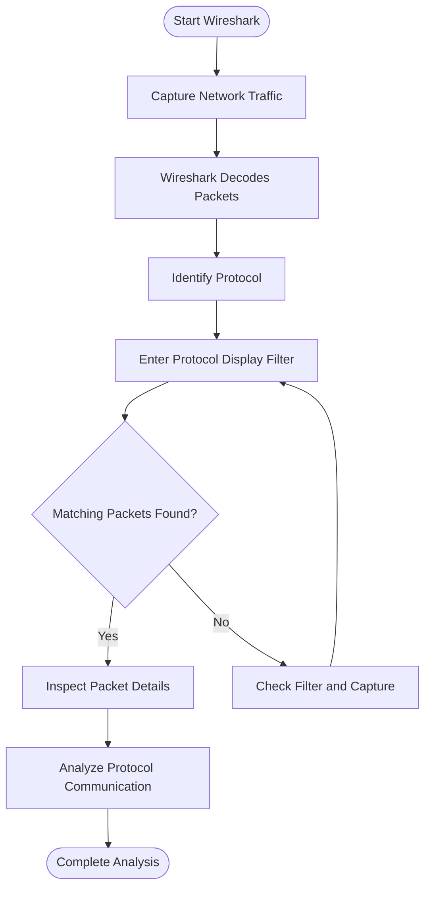

# Wireshark Protocol-Based Display Filters

> A detailed guide to identifying, filtering, and analyzing network protocols using Wireshark.

## 1. Introduction

Protocol-based display filters are used to isolate packets belonging to a particular network or application-layer protocol.

Wireshark supports numerous protocol dissectors that identify and decode network communication. Protocol filters make it easier to examine specific traffic without manually inspecting every captured packet.

For example:
- `tcp` displays TCP packets.
- `udp` displays UDP packets.
- `dns` displays DNS packets.
- `http` displays HTTP packets.

Protocol filters are particularly useful for network troubleshooting, protocol analysis, and understanding communication between devices.

## 2. How Protocol-Based Filtering Works

When Wireshark captures network traffic, it attempts to identify the protocols contained in each packet.

The display filter selects packets according to the protocol fields recognized by Wireshark.

### Protocol filtering workflow



## 3. Common Protocol-Based Display Filters

### 3.1 Ethernet and Network-Layer Protocols

| Display Filter | Description |
|---|---|
| `eth` | Displays Ethernet packets. |
| `arp` | Displays Address Resolution Protocol packets. |
| `ip` | Displays IPv4 packets. |
| `ipv6` | Displays IPv6 packets. |
| `icmp` | Displays ICMP packets. |
| `icmpv6` | Displays ICMPv6 packets. |
| `lldp` | Displays Link Layer Discovery Protocol packets. |
| `vlan` | Displays VLAN-tagged traffic recognized by Wireshark. |

### 3.2 Transport-Layer Protocols

| Display Filter | Description |
|---|---|
| `tcp` | Displays Transmission Control Protocol packets. |
| `udp` | Displays User Datagram Protocol packets. |
| `sctp` | Displays Stream Control Transmission Protocol packets. |
| `quic` | Displays QUIC protocol packets when recognized. |

### 3.3 Application-Layer Protocols

| Display Filter | Description |
|---|---|
| `dns` | Displays Domain Name System traffic. |
| `http` | Displays HTTP traffic. |
| `http2` | Displays HTTP/2 traffic when recognized. |
| `tls` | Displays Transport Layer Security traffic. |
| `dhcp` | Displays DHCP traffic when decoded under this protocol name. |
| `dhcpv6` | Displays DHCPv6 traffic. |
| `ftp` | Displays FTP traffic when recognized. |
| `smtp` | Displays Simple Mail Transfer Protocol traffic. |
| `pop` | Displays POP traffic when recognized. |
| `imap` | Displays IMAP traffic. |
| `ssh` | Displays SSH traffic. |
| `ntp` | Displays Network Time Protocol traffic. |
| `smb` | Displays Server Message Block traffic. |
| `snmp` | Displays Simple Network Management Protocol traffic. |

**Note:** The availability and exact protocol names depend on the installed Wireshark version and its protocol dissectors. Check the official Display Filter Reference for the current field and protocol catalogue.

## 4. Practical Protocol Filter Examples

### Example 1: Display TCP traffic

```wireshark
tcp
```

**Purpose:** Displays TCP packets captured by Wireshark.

**Analysis:**
- Identify source and destination IP addresses.
- Inspect source and destination ports.
- Examine TCP flags.
- Follow TCP streams.

### Example 2: Display UDP traffic

```wireshark
udp
```

**Purpose:** Displays UDP packets.

**Analysis:**
- Identify UDP source and destination ports.
- Examine packet lengths.
- Inspect DNS and other UDP-based communication.

### Example 3: Display DNS traffic

```wireshark
dns
```

**Purpose:** Displays DNS queries and responses.

**Analysis:**
- Identify requested domain names.
- Examine DNS query types.
- Check response codes.
- Investigate failed name resolution.

### Example 4: Display ICMP traffic

```wireshark
icmp
```

**Purpose:** Displays IPv4 ICMP communication.

**Analysis:**
- Identify Echo Requests and Echo Replies.
- Examine Destination Unreachable messages.
- Inspect Time Exceeded messages.
- Investigate connectivity problems.

### Example 5: Display HTTP traffic

```wireshark
http
```

**Purpose:** Displays HTTP packets recognized by Wireshark.

**Analysis:**
- Inspect HTTP request methods.
- Identify host fields.
- Examine response status codes.
- Review visible application data.

### Example 6: Display TLS traffic

```wireshark
tls
```

**Purpose:** Displays TLS packets recognized by Wireshark.

**Analysis:**
- Inspect TLS handshake messages.
- Examine available protocol metadata.
- Identify TLS versions and extensions where exposed.
- Understand encrypted communication.

Encrypted application payloads generally cannot be read as plaintext without suitable decryption material and configuration.

## 5. Combining Protocol Filters

Protocol filters can be combined using logical operators.

| Filter | Description |
|---|---|
| `tcp or udp` | Displays TCP and UDP traffic. |
| `dns or http` | Displays DNS or HTTP traffic. |
| `ip and tcp` | Displays IPv4 packets containing TCP. |
| `ip and udp` | Displays IPv4 packets containing UDP. |
| `tcp and not tls` | Displays TCP packets that do not match the TLS filter. |
| `icmp or icmpv6` | Displays ICMP and ICMPv6 traffic. |

### Example

```wireshark
tcp or udp or icmp
```

Displays TCP, UDP, and ICMP packets.

## 6. Practical Applications

| Application | Relevant Filter |
|---|---|
| TCP connection analysis | `tcp` |
| DNS troubleshooting | `dns` |
| Network connectivity testing | `icmp` |
| HTTP request analysis | `http` |
| Encrypted traffic inspection | `tls` |
| Address resolution analysis | `arp` |
| IPv6 communication analysis | `ipv6` |
| DHCP troubleshooting | `dhcp` |

## 7. Best Practices

1. Start with broad protocol filters.
2. Examine packet details after isolating a protocol.
3. Combine protocol filters when investigating related communication.
4. Use the Packet Details pane to understand protocol layers.
5. Verify that the expected traffic was captured.
6. Check the installed Wireshark version when a filter is unavailable.

## 8. Important Considerations

- A protocol filter displays packets recognized by Wireshark's dissectors.
- Some traffic may use non-standard ports or require additional decoding information.
- Encrypted protocols limit visibility into application payloads.
- Protocol identification does not independently establish whether traffic is legitimate or malicious.

## 9. References

- [Wireshark Official Website](https://www.wireshark.org/)
- [Official Display Filter Reference](https://www.wireshark.org/docs/dfref/)
- [Wireshark User Guide](https://www.wireshark.org/docs/wsug_html/)
- [Wireshark Display Filters Wiki](https://wiki.wireshark.org/DisplayFilters/)

---

**Protocol-Based Filtering – Identify. Isolate. Inspect. Analyze.**
