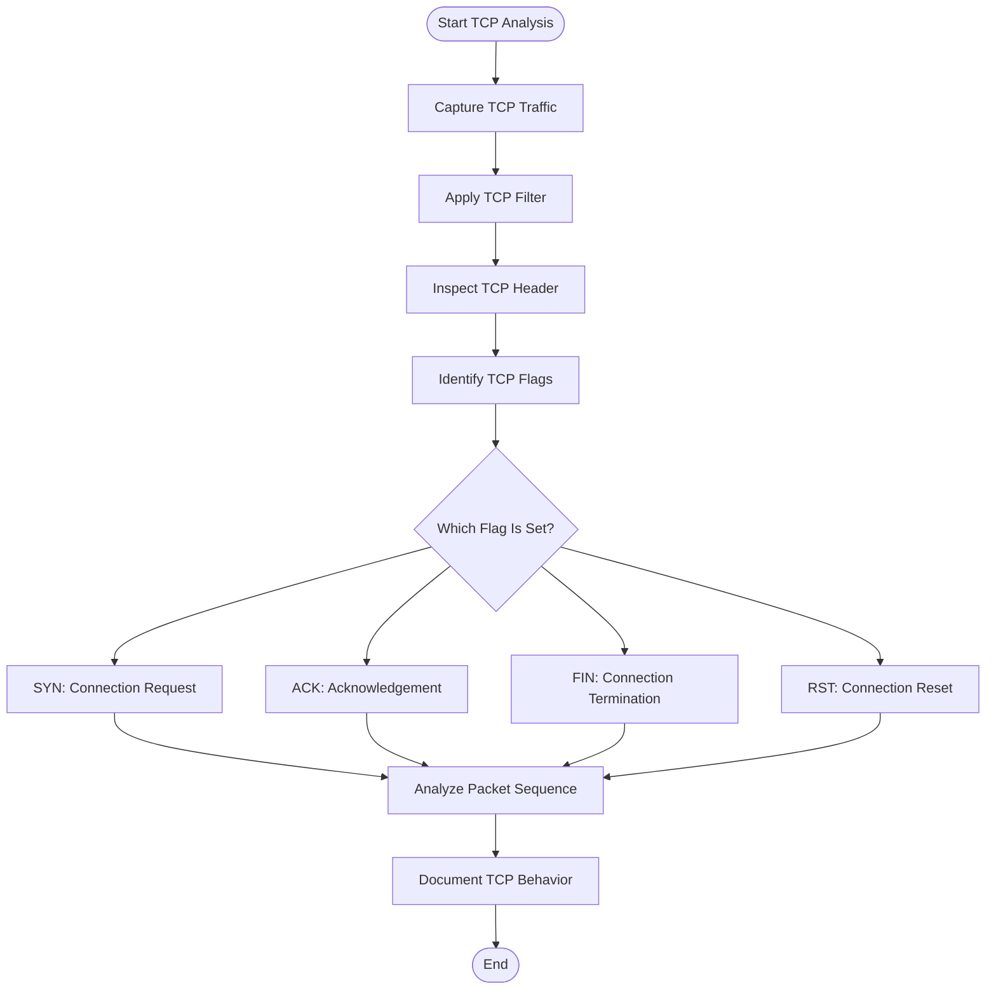
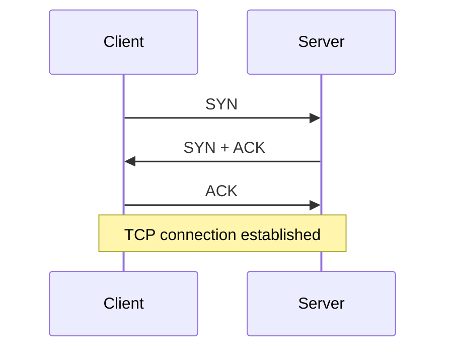
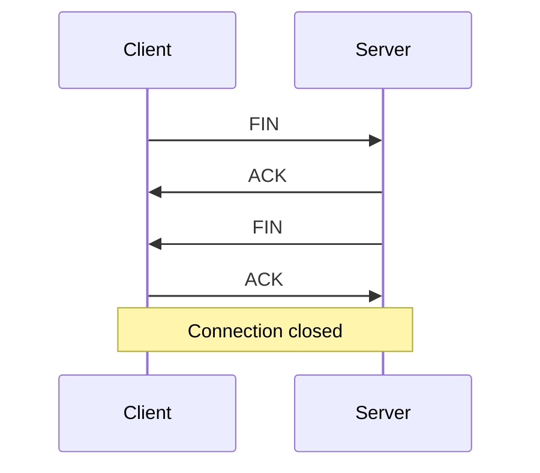

# Wireshark TCP Flag Display Filters

> A detailed guide to identifying TCP connection behavior using TCP control flags.

## 1. Introduction

Transmission Control Protocol (TCP) is a connection-oriented transport-layer protocol.

TCP uses control flags in its packet header to manage connection establishment, data transfer, acknowledgements, and connection termination.

Wireshark provides display-filter fields that allow users to inspect individual TCP flags.

TCP flag analysis is useful for:
- Understanding TCP connection establishment.
- Identifying connection termination.
- Investigating TCP resets.
- Examining communication behavior.
- Understanding connection patterns during troubleshooting.

## 2. TCP Header and Flags

A TCP header contains control information used to manage communication.

Important fields include:

- Source port
- Destination port
- Sequence number
- Acknowledgement number
- Header length
- Flags
- Window size
- Checksum
- Urgent pointer

### TCP control flags

| Flag | Meaning | Function |
|---|---|---|
| SYN | Synchronize | Initiates a TCP connection. |
| ACK | Acknowledgement | Acknowledges received data or connection information. |
| FIN | Finish | Indicates that the sender wants to close its sending direction. |
| RST | Reset | Resets or aborts a TCP connection. |
| PSH | Push | Requests prompt delivery of buffered data to the application. |
| URG | Urgent | Indicates that the urgent pointer is significant. |
| ECE | ECN Echo | Used for Explicit Congestion Notification signaling. |
| CWR | Congestion Window Reduced | Indicates a congestion-window reduction. |
| NS | Nonce Sum | ECN-related flag. |

## 3. TCP Flag Analysis Workflow



## 4. Individual TCP Flag Filters

### 4.1 SYN Flag

The SYN flag is used during TCP connection establishment.

```wireshark
tcp.flags.syn == 1
```

**Description:** Displays TCP packets with the SYN flag set.

To identify initial connection requests without ACK:

```wireshark
tcp.flags.syn == 1 and tcp.flags.ack == 0
```

**Analysis:**
- Identify the initiating host.
- Inspect the destination address.
- Examine destination port.
- Review the corresponding SYN-ACK response.

### 4.2 ACK Flag

The ACK flag indicates that the acknowledgement field is significant.

```wireshark
tcp.flags.ack == 1
```

**Description:** Displays TCP packets with the ACK flag set.

**Analysis:**
- Examine acknowledgement numbers.
- Review packet sequence.
- Understand TCP data acknowledgement.

### 4.3 FIN Flag

The FIN flag indicates that the sender is closing its sending direction.

```wireshark
tcp.flags.fin == 1
```

**Description:** Displays TCP packets with the FIN flag set.

**Analysis:**
- Identify connection termination.
- Inspect which endpoint sent FIN.
- Examine the subsequent acknowledgement.
- Review whether the other endpoint also sends FIN.

### 4.4 RST Flag

The RST flag is used to reset or abort a TCP connection.

```wireshark
tcp.flags.reset == 1
```

**Description:** Displays TCP packets with the RST flag set.

**Analysis:**
- Identify the sender.
- Examine the preceding packets.
- Inspect sequence and acknowledgement numbers.
- Determine whether the reset is expected or unexpected.

### 4.5 PSH Flag

The PSH flag requests prompt delivery of buffered data to the application.

```wireshark
tcp.flags.push == 1
```

**Description:** Displays TCP packets with the PSH flag set.

### 4.6 URG Flag

The URG flag indicates that the urgent pointer is significant.

```wireshark
tcp.flags.urg == 1
```

**Description:** Displays TCP packets with the URG flag set.

### 4.7 ECE Flag

```wireshark
tcp.flags.ece == 1
```

Displays packets with the ECE flag set.

### 4.8 CWR Flag

```wireshark
tcp.flags.cwr == 1
```

Displays packets with the CWR flag set.

### 4.9 NS Flag

```wireshark
tcp.flags.ns == 1
```

Displays packets with the NS flag set, where the field is available in the decoded TCP header.

## 5. TCP Three-Way Handshake Analysis

TCP uses a three-step handshake to establish a connection.

### Step 1: SYN

The client sends a SYN packet to request a connection.

```wireshark
tcp.flags.syn == 1 and tcp.flags.ack == 0
```

### Step 2: SYN-ACK

The server responds with SYN and ACK flags set.

```wireshark
tcp.flags.syn == 1 and tcp.flags.ack == 1
```

### Step 3: ACK

The client sends an acknowledgement.

```wireshark
tcp.flags.ack == 1
```

The ACK filter also matches many other TCP packets, so inspect the packet sequence and stream rather than assuming every matching ACK is the final handshake packet.

### Three-way handshake diagram



## 6. TCP Connection Termination

A typical orderly TCP connection shutdown uses FIN and ACK exchanges in both directions.



Useful filters:

```wireshark
tcp.flags.fin == 1
```

```wireshark
tcp.flags.reset == 1
```

## 7. Combined TCP Flag Filters

| Display Filter | Description |
|---|---|
| `tcp.flags.syn == 1 and tcp.flags.ack == 0` | Initial SYN packets. |
| `tcp.flags.syn == 1 and tcp.flags.ack == 1` | SYN-ACK packets. |
| `tcp.flags.fin == 1 and tcp.flags.ack == 1` | FIN packets with ACK set. |
| `tcp.flags.reset == 1 and tcp` | TCP reset packets. |
| `tcp.flags.push == 1 and tcp.flags.ack == 1` | TCP packets with PSH and ACK set. |
| `tcp.flags.syn == 1 or tcp.flags.fin == 1` | TCP packets with SYN or FIN set. |

## 8. Practical Analysis Scenarios

### Scenario 1: Identify initial connection requests

```wireshark
tcp.flags.syn == 1 and tcp.flags.ack == 0
```

Use this filter to identify initial SYN packets and examine connection initiation patterns.

### Scenario 2: Identify reset connections

```wireshark
tcp.flags.reset == 1
```

Use this filter to inspect TCP resets and determine their surrounding communication context.

### Scenario 3: Examine connection termination

```wireshark
tcp.flags.fin == 1
```

Use this filter to inspect graceful TCP shutdown behavior.

### Scenario 4: Examine SYN-ACK responses

```wireshark
tcp.flags.syn == 1 and tcp.flags.ack == 1
```

Use this filter to inspect server responses during connection establishment.

## 9. Best Practices

1. Begin with the general `tcp` filter.
2. Inspect the TCP header in the Packet Details pane.
3. Use individual flag filters to isolate connection events.
4. Examine packets before and after a matching packet.
5. Use Follow TCP Stream to understand a conversation.
6. Check sequence and acknowledgement numbers.
7. Do not interpret a flag in isolation.

## 10. Important Considerations

- SYN packets do not automatically indicate malicious activity.
- RST packets may be normal in some connection scenarios.
- FIN and ACK flags can appear together.
- Many TCP data packets have ACK set.
- A TCP flag filter identifies a header condition, not the cause of the communication behavior.

## 11. References

- [Official TCP Display Filter Reference](https://www.wireshark.org/docs/dfref/t/tcp.html)
- [Wireshark User Guide](https://www.wireshark.org/docs/wsug_html/)
- [Wireshark Display Filters Wiki](https://wiki.wireshark.org/DisplayFilters/)

---

**TCP Flag Analysis – Establish. Acknowledge. Terminate. Investigate.**
