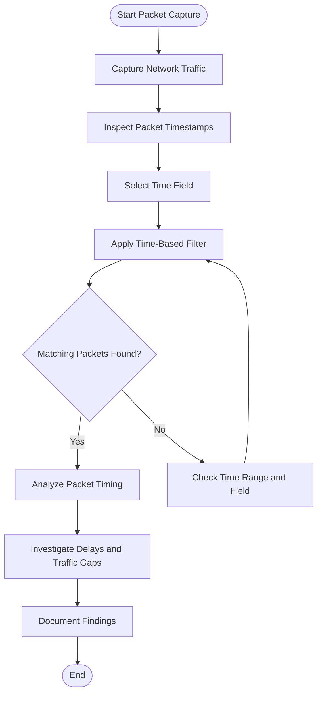

# Wireshark Time-Based Display Filters

> A detailed guide to analyzing packet timestamps, relative capture time, and time intervals between packets.

## 1. Introduction

Time-based display filters are used to examine packets according to their timestamps and timing information.

Packet timing is important for understanding communication sequences, investigating traffic gaps, and analyzing packet arrival patterns.

Wireshark provides frame-related time fields that can help examine:
- Absolute packet timestamps.
- Time elapsed since capture began.
- Time differences between captured packets.
- Time differences between displayed packets.

Time-based filters are useful in network troubleshooting and performance analysis.

## 2. Understanding Packet Time Fields

Wireshark provides multiple timestamp-related fields.

| Field | Description |
|---|---|
| `frame.time` | Absolute date and time associated with the captured frame. |
| `frame.time_epoch` | Frame timestamp represented as Unix epoch time. |
| `frame.time_relative` | Time elapsed since the beginning of the capture. |
| `frame.time_delta` | Time difference from the preceding captured packet. |
| `frame.time_delta_displayed` | Time difference from the preceding displayed packet. |

## 3. Time-Based Analysis Workflow



## 4. Common Time-Based Display Filters

### 4.1 Absolute Timestamp

```wireshark
frame.time
```

Displays frames containing the absolute timestamp field.

The field itself is useful for inspection; use a comparison expression when you need to select a particular timestamp or interval.

### 4.2 Unix Epoch Timestamp

```wireshark
frame.time_epoch
```

Displays frames containing the Unix epoch timestamp field.

### 4.3 Relative Capture Time

```wireshark
frame.time_relative > 10
```

Displays packets captured more than 10 seconds after the capture began.

```wireshark
frame.time_relative <= 30
```

Displays packets captured within the first 30 seconds of the capture.

```wireshark
frame.time_relative >= 10 and frame.time_relative <= 20
```

Displays packets captured between 10 and 20 seconds after capture start.

### 4.4 Time Difference Between Captured Packets

```wireshark
frame.time_delta > 1
```

Displays packets whose time difference from the preceding captured packet is greater than one second.

```wireshark
frame.time_delta <= 0.1
```

Displays packets whose time difference from the preceding captured packet is 100 milliseconds or less.

### 4.5 Time Difference Between Displayed Packets

```wireshark
frame.time_delta_displayed > 1
```

Displays packets whose time difference from the preceding displayed packet is greater than one second.

This field is useful when analyzing time gaps after applying other display filters.

## 5. Practical Time-Based Filters

| Display Filter | Description |
|---|---|
| `frame.time_relative > 5` | Packets captured more than 5 seconds after capture start. |
| `frame.time_relative > 10` | Packets captured more than 10 seconds after capture start. |
| `frame.time_relative <= 30` | Packets captured within the first 30 seconds. |
| `frame.time_relative >= 10 and frame.time_relative <= 20` | Packets captured from 10 to 20 seconds after capture start. |
| `frame.time_delta > 1` | Packet time difference from the preceding captured packet greater than 1 second. |
| `frame.time_delta > 0.5` | Packet time difference greater than 500 milliseconds. |
| `frame.time_delta_displayed > 1` | Time difference from the preceding displayed packet greater than 1 second. |

## 6. Practical Analysis Examples

### Example 1: Analyze the first 30 seconds

```wireshark
frame.time_relative <= 30
```

**Purpose:** Isolate the initial 30 seconds of a capture.

**Analysis:**
- Examine the initial connection requests.
- Identify DNS lookups.
- Observe TCP handshakes.
- Review the sequence of application communication.

### Example 2: Inspect traffic after 60 seconds

```wireshark
frame.time_relative > 60
```

**Purpose:** Display packets captured more than one minute after capture start.

### Example 3: Identify large packet time gaps

```wireshark
frame.time_delta > 1
```

**Purpose:** Identify packets separated from the preceding captured packet by more than one second.

**Analysis:**
- Identify the preceding packet.
- Check whether the same communication stream is involved.
- Inspect packet sequences.
- Review the capture interface and capture completeness.

### Example 4: Analyze timing within a selected protocol

```wireshark
tcp and frame.time_relative >= 10 and frame.time_relative <= 30
```

**Purpose:** Display TCP packets captured between 10 and 30 seconds after capture start.

### Example 5: Examine DNS packet timing

```wireshark
dns and frame.time_delta > 0.5
```

**Purpose:** Display DNS packets with a time difference from the preceding captured packet greater than 500 milliseconds.

This does not directly measure DNS response time. To measure a DNS transaction, correlate a query with its corresponding response.

## 7. Packet Timing Analysis

### Understanding the difference between time fields

| Field | What It Measures |
|---|---|
| `frame.time_relative` | Time since capture start. |
| `frame.time_delta` | Time since the preceding captured packet. |
| `frame.time_delta_displayed` | Time since the preceding displayed packet. |

### Example

Suppose a capture contains packets at these relative times:

| Packet | Relative Time |
|---:|---:|
| 1 | 0.000 s |
| 2 | 0.100 s |
| 3 | 0.250 s |
| 4 | 1.500 s |
| 5 | 1.600 s |

The approximate differences are:

| Packet | Time Difference |
|---:|---:|
| 2 | 0.100 s |
| 3 | 0.150 s |
| 4 | 1.250 s |
| 5 | 0.100 s |

A filter such as:

```wireshark
frame.time_delta > 1
```

would match packet 4 in this example.

## 8. Important Distinction: Packet Interval vs Network Latency

A time difference between captured packets is not necessarily network latency.

For example:
- A large `frame.time_delta` may simply mean no packet was captured during that interval.
- A packet may be delayed by application behavior rather than the network.
- A capture may omit traffic due to packet drops or interface limitations.

To investigate actual transaction timing, correlate request and response packets using protocol-specific fields, stream information, and timestamps.

## 9. Best Practices

1. Use `frame.time_relative` to inspect capture stages.
2. Use `frame.time_delta` to investigate packet intervals.
3. Use `frame.time_delta_displayed` when analyzing a filtered packet list.
4. Correlate packets belonging to the same conversation.
5. Compare timestamps with protocol events.
6. Check capture completeness before concluding that traffic was delayed.
7. Use appropriate precision when interpreting short time intervals.

## 10. References

- [Frame Display Filter Reference](https://www.wireshark.org/docs/dfref/f/frame.html)
- [Wireshark User Guide](https://www.wireshark.org/docs/wsug_html/)
- [Building Display Filter Expressions](https://www.wireshark.org/docs/wsug_html_chunked/ChWorkBuildDisplayFilterSection.html)
- [Wireshark Display Filter Manual](https://www.wireshark.org/docs/man-pages/wireshark-filter)

---

**Time-Based Filtering – Measure. Compare. Investigate.**
